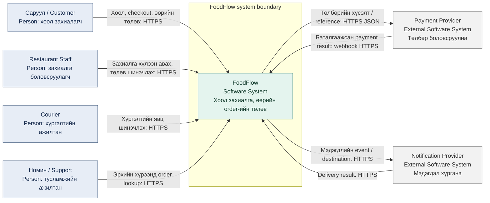
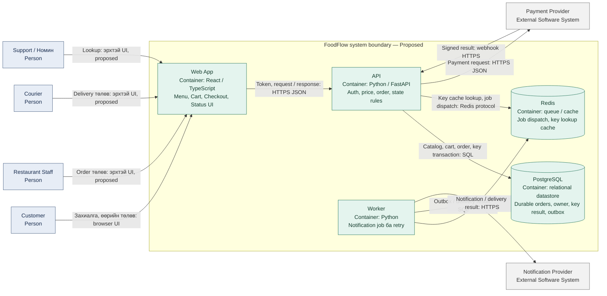

# FoodFlow — Архитектурын баримт

**Загвар:** arc42 §1, §3, §5 · **Зураг:** C4 Context / Container · **Төлөв:** Proposed target architecture · **Шалгасан:** 2026-10-13

Энэ баримт нь FoodFlow-ийн зорьж буй системийн хил, бүрэлдэхүүн хэсгийн үүрэг, өгөгдлийн урсгалыг тайлбарлана. Одоогийн repository дахь W06 Python жишээ модуль нь таван container бүхий ажиллаж буй систем биш. React, FastAPI, PostgreSQL, Redis болон provider integration-ийг энд **санал болгосон архитектур** гэж уншина.

Уншигчид: Ану шиг API ашиглах frontend хөгжүүлэгч; Билэгт шиг backend хөгжүүлэгч; Номин шиг support ажилтан; QA болон архитектурын reviewer. [Persona](../audience/personas.md), [Scope Charter](../requirements/scope.md), [SRS](../requirements/srs.md), [ADR индекс](adr/index.md), [W04 тайлан](../semesters/week-04.md).

## arc42 §1 — Зорилго ба сонирхогч талууд

FoodFlow нь Customer-ийн Menu → Cart → Checkout → Order Status / History урсгалыг дэмжинэ. Архитектурын гол зорилго нь хариуцлага, мэдээллийн эзэмшил, гаднын үйлчилгээний хил, алдааны нөхцөлийг уншигчид шууд харагдуулах юм.

| Quality goal | Шаардлага | Архитектурт үзүүлэх нөлөө |
| --- | --- | --- |
| Давхар захиалга үүсгэхгүй байх | FR-11, NFR-02 | Key/payload-ийн гэрээ; durable unique constraint; transaction; retry test |
| Өөр хүний мэдээллийг хамгаалах | FR-12–14, NFR-03 | API дээр owner/role шалгах; datastore query-д ownership scope; мэдээлэлгүй error |
| Хэрэглэгчийн урсгалыг ойлгомжтой байлгах | FR-01–15, NFR-05 | UI-ийн тодорхой төлөв, keyboard test, success/error contract |
| Menu-ийн mobile LCP | NFR-01 | Frontend-ийн ачаалал ба каталогийн dependency; API latency-тай metric-ийг хольж болохгүй |
| Core ordering API-ийн availability | NFR-04 | Synthetic ordering probe, datastore/provider fault handling; 30 хоногийн evidence |

| Stakeholder | Гол асуулт | Архитектурт авах хариу |
| --- | --- | --- |
| Саруул — Customer, зохиомол end-end user | Захиалга үүссэн үү, дараа нь юу болох вэ? | API order + UI confirmation; төлөвийн эх үүсвэр |
| Ану — frontend developer persona | Token, request/response, error нэг гэрээтэй юу? | Web App↔API, ADR-001/003, OpenAPI |
| Билэгт — backend developer persona | Давтан POST, transaction, өгөгдлийн owner хаана вэ? | PostgreSQL↔Redis-ийн үүрэг, ADR-002 |
| Номин — support persona | Төлөв/алдааны утгыг хэрхэн тайлбарлах вэ? | API-ийн status/error; зөвшөөрөгдсөн lookup-ийн хил |
| Restaurant staff / courier | Төлөвийг аль системд шинэчлэх вэ? | Гаднын actor→API; staff portal-ийн дэлгэрэнгүй нь нээлттэй scope |
| QA / operations | Ямар boundary-г, ямар fault-аар шалгах вэ? | SRS test case, provider boundary, probe, ADR confirmation |

Persona нь эх материалд зохиомол гэж тэмдэглэгдсэн. Тэдгээрээс архитектурын сонголтыг тайлбарлаж болох боловч бодит ярилцлага эсвэл багийн зөвшөөрөл гэж ашиглахгүй.

## arc42 §3 — Системийн хил ба орчин

FoodFlow-ийн хил дотор Web App, API, Worker, PostgreSQL, Redis байна. Payment Provider ба Notification Provider нь гаднын систем. Provider-ийн бодит бүтээгдэхүүний нэр, URL, credentials, үйлчилгээний нөхцөлийг батлаагүй.

### C4 Level 1 — System Context

**Тайлбар:** `Person` — системийн гаднах хүн; `Software System` — системийн хайрцаг; ногоон — FoodFlow-ийн хил дотор, саарал — provider. Сум нь хүсэлт эсвэл мэдээллийн урсгалын чиглэлийг, шошго нь агуулга ба протоколыг заана. Хариу урсгалыг тусад нь зурсан холбоос нь async provider-ийн хил тодруулах зорилготой. [Засварлах Mermaid эх](diagrams/context.mmd) · [Засварлах SVG vector](diagrams/context.svg).

Context-д дөрвөн runtime actor ба хоёр хөрш систем бий. Ану, Билэгт нь баримтын уншигч/хэрэгжүүлэгч; хоол захиалах runtime хэрэглэгч мэт дүрслээгүй. Staff/courier нь FR-12-ийн төлөвийн эх үүсвэр, Номины persona-тай холбоотой; тэдний бүрэн интерфейсийг Customer SRS баталсан гэж үзэхгүй.

### Хил дамнах өгөгдлийн гэрээ

| Хил | Орох / гарах мэдээлэл | Хяналт ба нээлттэй шийдвэр |
| --- | --- | --- |
| Customer↔FoodFlow | Хоол, cart, хаяг, payment method, order_id, total, ETA, status | Token ба order ownership; хаяг/утсыг log-д ил гаргахгүй |
| Staff/courier↔FoodFlow | Зөвшөөрөгдсөн order, state transition | Role matrix ба transition endpoint-ийг баталгаажуулах |
| Support↔FoodFlow | Эрхийн хүрээтэй lookup, error code, status | SRS нь support бүх хүний order-ийг чөлөөтэй харах эрх олгоогүй |
| FoodFlow↔Payment Provider | Payment reference, amount, provider token/result | Raw card number хадгалахгүй; webhook signature/dedup/timeout гэрээ нээлттэй |
| FoodFlow↔Notification Provider | Order event, destination, delivery result | Retry limit, timeout, consent/retention гэрээ нээлттэй |

Төлбөр timeout болсон үед мөнгө шилжээгүй гэж ч, амжилттай гэж ч сохроор дүгнэхгүй. Payment state-ийг provider-ийн баталгаатай үр дүнгээр reconcile хийх арга шаардлагатай. Энэ нь шийдвэрлэх дизайн; repository-д хэрэгжсэн гэсэн үг биш.

## arc42 §5 — Building Block View

### C4 Level 2 — Container

C4 дахь container нь application эсвэл datastore-ийн хил. Docker container гэсэн ганц утгатай биш; deployment cluster/load balancer-ийн зураг мөн биш. Доорх **таван** container нь W04-ийн ≤8 хязгаарт багтана. [C4-ийн албан тайлбар](https://c4model.com/diagrams/container), [notation](https://c4model.com/diagrams/notation).

**Тайлбар:** Хайрцаг бүр нэр, элемент/технологи, гол үүрэгтэй. Цилиндр — datastore; бүх холбоос агуулга, протоколтой. Staff/courier/support UI нь scope шийдвэрийг хүлээж буй interface; Customer-ийн бэлэн screen гэж тэмдэглээгүй. [Mermaid эх](diagrams/container.mmd) · [SVG vector](diagrams/container.svg).

### Таван container-ийн black-box тайлбар

| Container | Responsibility ба эзэмших өгөгдөл | Гол interface | SRS холбоо | Хэрэгжүүлэлтийн байдал / эрсдэл |
| --- | --- | --- | --- | --- |
| Web App — React / TypeScript | Customer UI; loading/error/success state; keyboard flow. Серверийн үнийг UI дур мэдэн батлахгүй | Browser; HTTPS/JSON API client | FR-01–15; NFR-01/05 | Proposed; frontend source байхгүй; generated client/version нээлттэй |
| API — Python / FastAPI | Auth/owner/role, Catalog/Cart/Checkout/Orders, server pricing, state rules, provider coordination | `/api/v1`; SQL; Redis; payment HTTPS | FR-01–15; NFR-02/03/04 | Proposed; W06 module нь HTTP server биш; schema/auth integration нээлттэй |
| Worker — Python | Notification job, хязгаартай retry, delivery result, committed outbox dispatch | Redis queue; SQL; notification HTTPS | FR-15-д нэмэлт дэмжлэг; NFR-04 | Proposed; UI confirmation-ийг Worker-ээр орлуулахгүй; retry/poison job policy нээлттэй |
| PostgreSQL | Catalog, cart, order, ownership, status history, payment result; idempotency record, outbox-ийг transaction-тай хадгалах санал | SQL / transactional writes | FR-01–06/08–14; NFR-02/03/04 | Proposed; UNIQUE(owner,key), payload hash, migration/backup test нээлттэй |
| Redis | Job dispatch ба хурдасгах key lookup cache; order-ийн үнэн эх сурвалж болохгүй | Redis protocol; queue ack | FR-11; NFR-02; async notification | Proposed; cache loss-ийг duplicate болгож болохгүй; outage fallback нээлттэй |

`outbox`, durable key/result, payload hash нь хуучин W04-ийн найдвартай ажиллагааны цоорхойг засах **дизайны санал**. [ADR-002](adr/0002-persistence-and-idempotency.md)-ыг зөвшөөрч, migration/transaction code ба fault test нэмтэл хэрэгжсэн гэж тооцохгүй. Redis key шалгаад дараа нь PostgreSQL-д order бичих хоёр тусдаа алхам дангаараа concurrency crash-д duplicate-гүй баталгаа өгдөггүй.

### API-ийн Level 2 логик блок

Эдгээр нь API container доторх логик үүргүүд; тусдаа microservice/deployment нэмээгүй.

| Building block | Үүрэг | Requirement IDs |
| --- | --- | --- |
| Catalog | Идэвхтэй хоол, хайлт, ангилал, detail | FR-01–03 |
| Cart | Add, quantity boundary, remove | FR-04–06 |
| Pricing | Server subtotal + fee − discount | FR-07 |
| Checkout | Address, slot, payment method validation | FR-08–10 |
| Orders | Create, own read, cancellation, history, confirmation data | FR-11–15 |
| Authorization | Request identity, owner/role scope | FR-12–14; NFR-03 |
| Idempotency / persistence | Key scope, unique reservation/result, transaction | FR-11; NFR-02 |
| Provider adapters | Payment state, webhook, notification dispatch | FR-10/11; FR-15-д нэмэлт |

15/15 FR нь хариуцах блоктой; архитектурын orphan=0, document mapping=100%. Энэ нь W04-ийн ≥80% зураглалын шалгуурыг давна. Хэрэгжүүлэлт ба verification-ийн gap-ийг [мөрдөх хүснэгт](../requirements/traceability.md)-д тусад нь харуулсан. Ялангуяа **FR-15 нь Web App + API-ийн амжилтын баталгаа**; өмнөх Worker-only mapping-ийг зассан.

### Захиалга үүсэх санал болгосон урсгал

1. Web App нь token, `Idempotency-Key`, checkout data-г API-д илгээнэ.
2. API identity, ownership, cart, хаяг, payment method, үнийг шалгана. Ижил key өөр payload-тай бол тодорхой conflict буцаах гэрээ шаардлагатай.
3. API нь durable key reservation/result ба order write-ийг PostgreSQL transaction-ийн хамгаалалтаар нэгтгэнэ. Төлбөрийн гаднын HTTP дуудлагыг урт DB transaction-ийн дотор сохроор хийхгүй; payment state machine/reconciliation-ийг тусад нь батална.
4. Баталгаажсан order event-ийг transaction-тай outbox-д хадгалах саналтай. Queue dispatch дахин оролдож болох бөгөөд Worker duplicate event-ийг таних ёстой.
5. API нь order_id, total, ETA-ийн баталгаатай эх үүсвэртэй response өгнө; Web App FR-15-ийн confirmation-ийг харуулна. Worker-ийн notification delivery failure нь өмнө нь үүссэн order-ийг алга болгохгүй.

Core ordering availability нь Redis/provider тасарсан үеийн бодлогоос хамаарна. Fail-closed, durable fallback, payment pending төлөвийн аль хувилбарыг сонгохыг баг батлах ёстой; “бүгд тасарсан ч ажиллана” гэж амлахгүй.

## ADR ба архитектурын нээлттэй асуудал

[ADR индекс](adr/index.md) нь Tech Stack, Persistence, Interface, UE-4 Refactoring гэсэн дөрвөн тэмдэглэлтэй. Бүгд **Proposed**; decision owner болон approval evidence хараахан байхгүй.

| Асуудал | Нөлөөлөх зүйл | Дараагийн нотолгоо |
| --- | --- | --- |
| FR-13 Confirmed cancellation | SRS ↔ W06 Pending-only | Product decision, state table, contract/unit tests |
| Key-ийн TTL/scope/result, Redis outage | FR-11, NFR-02/04 | ADR-002 approval, DB uniqueness, concurrency/restart test |
| Provider webhook/payment reconciliation | FR-10/11/15 | Provider contract, signed callback fixture, timeout test |
| Staff/courier/support эрх ба UI | Context ↔ Customer scope | Role matrix, privacy review, endpoint scope decision |
| ETA эх үүсвэр | FR-15 | Data owner, fallback, truthful UI acceptance |
| Notification/event consistency | Async side effects | Outbox choice, at-least-once semantics, duplicate event test |

## UE-4 — Өмнөх/дараах зураг

Anti-pattern-ийн [өмнөх/дараах тайлбар](ue-4-rework.md), [нэг нүүрт багтаах ADR-004](adr/0004-container-responsibilities.md), Mermaid эх файлуудыг хадгалсан. Сургалтын deliberately flawed diagram-ийг production architecture мэт ашиглахгүй.

## Эх сурвалж ба хэрэглэсэн хүрээ

[Хэрэглэгчийн W04 тайлангийн текст](../../sources/README.md), [W04 lab assignment](../../sources/README.md), [arc42 Building Block View](https://docs.arc42.org/section-5/), [C4 Container](https://c4model.com/diagrams/container), [C4 Notation](https://c4model.com/diagrams/notation), [MADR](https://adr.github.io/madr/). Албан эх сурвалжийг 2026-10-13-нд шалгасан. arc42-ийн §1/3/5-ыг ашигласан нь бүтэн 12 хэсэгтэй архитектурын баримт эсвэл формал стандартын compliance баталсан гэсэн үг биш.
