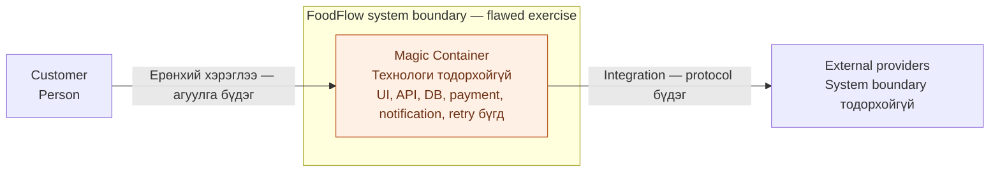
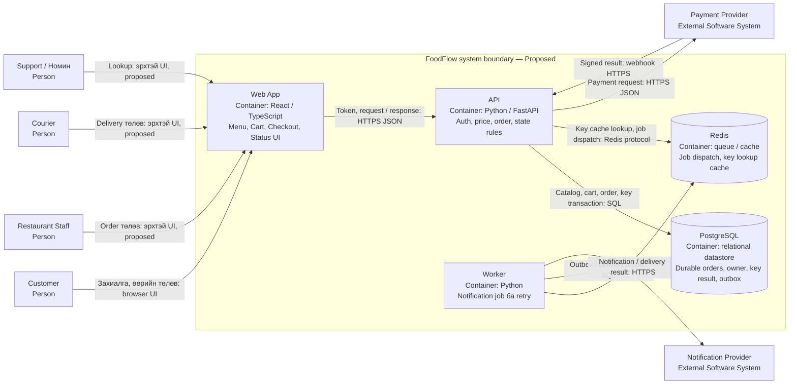

# UE-4 — C4 Container-ийн anti-pattern засвар

**Төрөл:** тусдаа сургалтын дасгал · **Статус:** диаграм/тайлбар бэлэн, багийн approval pending · **Шалгасан:** 2026-10-13

Зорилго нь нэргүй хариуцлагыг уншигчид ойлгомжтой блок, хил, урсгал болгон задлах. Энэ дасгал FoodFlow-ийн ажилладаг application-ийг refactor хийсэн гэсэн тайлан биш.

## Өмнөх зураг — Magic Container

[Засварлах эх](diagrams/ue4-before.mmd) · [Өмнөх SVG](diagrams/ue4-before.svg). Anti-pattern нь container-ийн хариуцлага ба технологи тодорхойгүй, provider-ууд ялгараагүй, мэдээллийн owner, retry, order confirmation-ийн зам харагдахгүй байгаад оршино. Суманд бүдэг утгыг зориуд тэмдэглэсэн.

## Засварлах зам

| Алхам | Илэрсэн асуудал | Дараах зурагт өгсөн хариу |
| --- | --- | --- |
| Reader-ийн эхлэх цэг | Хэрэглэгч ямар үйлдлээр эхлэх нь бүдэг | Customer→Web App; бусад runtime actor-ыг мөн нэрлэсэн |
| Хариуцлага | UI/business/data/retry нэг хайрцагт | Web App, API, Worker, PostgreSQL, Redis |
| Өгөгдлийн owner | Durable order хаана байгааг мэдэхгүй | PostgreSQL; Redis нь queue/cache |
| Системийн хил | Payment/messaging манайх эсэх нь бүдэг | Provider-ууд boundary-ийн гадна |
| Холбоос | “Integration” бүхнийг нуусан | HTTPS/JSON, SQL, Redis protocol, signed webhook |
| Шаардлагын утга | FR-15 notification-той холилдсон | UI confirmation үндсэн, Worker нэмэлт |

Bhatti-ийн “цааснаас эхлэх → уншигчийн эхлэх цэг → шошго өгөх” зарчмыг W04 handout-аас загварчлалын checklist болгон хэрэглэсэн. Өмнөх эх тайланд цаасан ноорог дурдсан боловч шинэ workshop/цаасан sketch-ийн нотолгоо зохиогоогүй.

## Дараах зураг — Тодорхой үүрэгтэй таван container

[Дараах Mermaid эх](diagrams/ue4-after.mmd) · [Дараах SVG](diagrams/ue4-after.svg) · [Нэг нүүрийн ADR-004](adr/0004-container-responsibilities.md). After-ийн topology нь үндсэн [Container view](index.md#c4-level-2--container)-тэй ижил. Технологи/үүргийг өөрчлөхөд хоёуланг нэг PR-д шинэчилнэ.

SVG нь offline report-д ашиглах тогтмол layout-тай editable export; Mermaid нь diagram-as-code суурь. Дахин үүсгэх: `python docs/architecture/diagrams/export_svg.py`. Хоёр дүрслэлийн topology ба шошгыг өөрчлөлт бүрд хамт review хийнэ.

## Review шалгуур

- Дөрвөн actor ба хоёр external provider тодорхой нэртэй, үндсэн Context-тэй таарна.
- Boundary дотор таван container; хайрцаг бүр Name + Technology + Responsibility-тэй.
- Бүх relationship нь үйлдэл/өгөгдөл ба protocol-той.
- SRS-ийн 15 FR хариуцах блоктой; implementation gap-ийг тусдаа бүртгэсэн.
- ADR нь Proposed; батлаагүй deployment/benchmark/peer review мэдүүлэггүй.

Эх сурвалж: [W04 assignment](../../sources/README.md), хэрэглэгчийн [PHTBB4](../../sources/README.md), [C4 notation](https://c4model.com/diagrams/notation).
