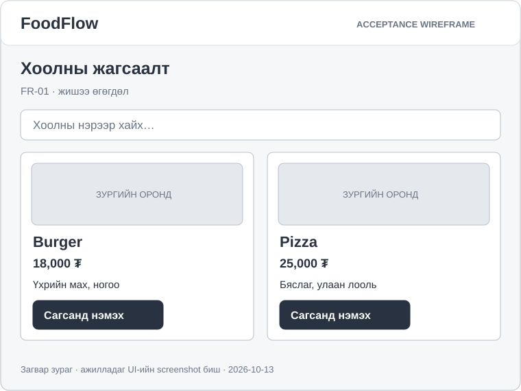
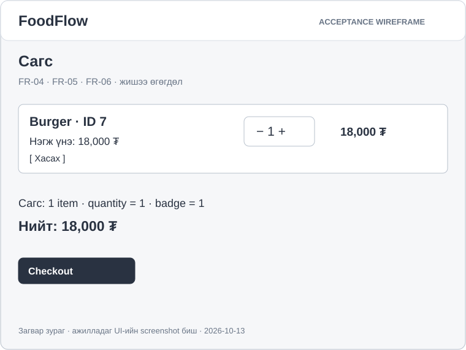
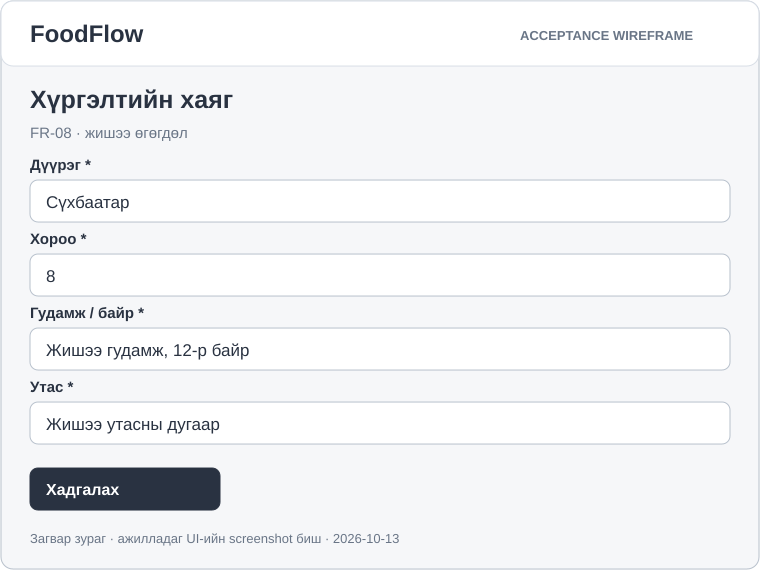
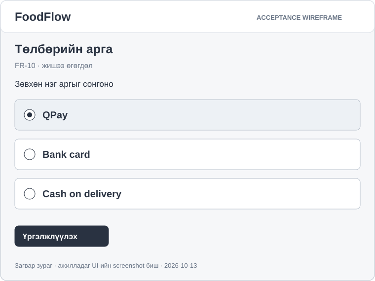
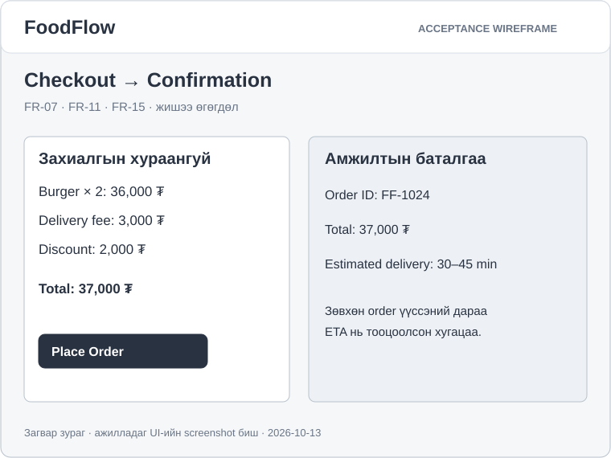
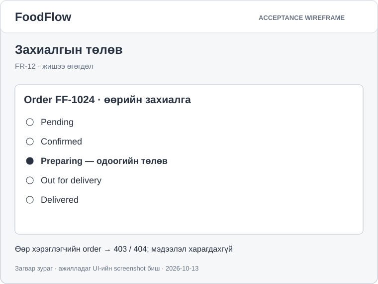
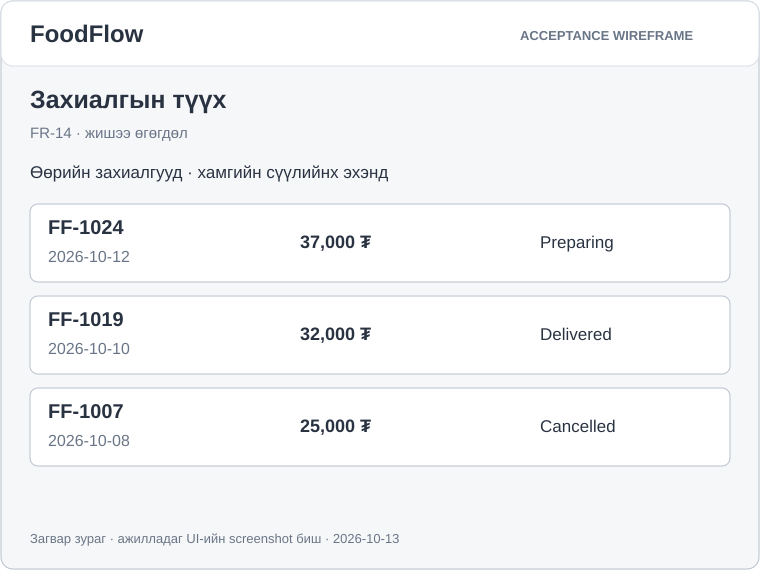

# Acceptance mock UI

Эдгээр нь SRS-ийн харагдах үр дүнг тайлбарлах **редакцийн wireframe**. Хэрэглэгчийн шинэ W03 материал дахь mock UI-ийн шаардлагад нийцүүлэн дахин байгуулсан; эх DOCX-ийн зургийг шууд хуулсан эсвэл ажилладаг системийн screenshot гэж мэдүүлээгүй. SVG файл бүр текст/shape-аар засварлагдана.

| Mock | Requirement | Шалгах зүйл |
| --- | --- | --- |
| Menu | FR-01 | Нэр, үнэ, зураг, товч тайлбар |
| Cart | FR-04 / FR-05 / FR-06 | Item ID, quantity, badge, subtotal, remove |
| Address | FR-08 | Дөрвөн required талбар |
| Payment | FR-10 | Дэмжих гурван аргаас нэг сонголт |
| Summary / Confirmation | FR-07 / FR-11 / FR-15 | Үнэ; Place Order; order_id, total, ETA |
| Status | FR-12 | Өөрийн order-ийн одоогийн төлөв |
| History | FR-14 | Зөвхөн өөрийн order; newest-first |

## Menu — FR-01

## Cart — FR-04 / FR-05 / FR-06

## Address — FR-08

## Payment — FR-10

## Summary ба Confirmation — FR-07 / FR-11 / FR-15

## Status — FR-12

## History — FR-14

Дахин үүсгэх: `python docs/requirements/mockups/generate_mockups.py`. Жишээ үнэ, order ID, хугацаа нь fixture; бодит хэрэглэгчийн өгөгдөл биш. Mock-ийн гоо зүй нь acceptance test-ийн орлуулга биш; шалгах алхам, Pass/Fail нь [SRS](../srs.md)-д байна.
